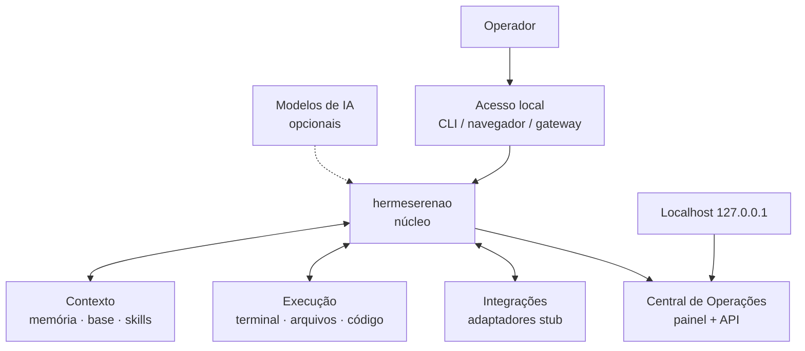

# Arquitetura

O sistema é um painel de controle local para uma infraestrutura de agente autônomo. Todos os componentes são lidos do filesystem; nenhum dado sai da máquina.

## Camadas

- **Acesso**: CLI (`hermeserenao.py`) e navegador. O gateway local registra eventos em `state/events.jsonl`.
- **Núcleo**: coordena consultas, status e skills. Não chama modelo de linguagem nesta versão.
- **Contexto**: `context/AGENTS.md`, índices recursivos e documentos Markdown. A busca de `/api/ask` devolve trecho, arquivo e linha.
- **Execução**: ambiente Python local; terminal, arquivos e código disponíveis para o operador.
- **Integrações**: `integrations/adapters.py` descreve capacidades sem autenticar em nenhum serviço.
- **Central**: API HTTP e painel em `app/static/index.html`.

## States

`ok` = componente real e verificável. `demo` = simulação local, sem efeito externo. `off` = ausente ou desabilitado.
