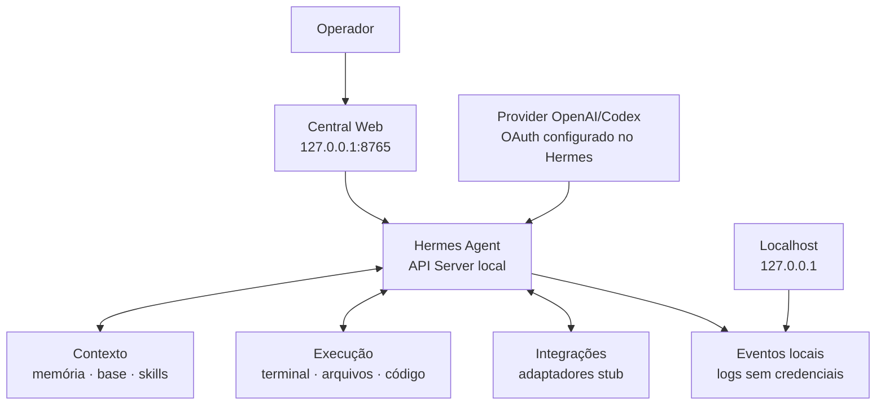

# Arquitetura

A Central Web local encaminha mensagens ao Hermes Agent pelo API Server que escuta em loopback. O provider/modelo é o já autenticado no Hermes (OpenAI/Codex Subscription); não há conexão direta do projeto com a API OpenAI.

## Camadas

- **Acesso**: painel em `127.0.0.1:8765`; a chave nunca chega ao navegador.
- **Runtime**: API Server do Hermes em `127.0.0.1:8642`; usa a autenticação de modelo já configurada no Hermes e suas ferramentas/permissões atuais.
- **Contexto**: documentos Markdown em `context/`; cada turno injeta até cinco trechos recuperados, com caminho e linha. Trechos são tratados como dados não confiáveis.
- **Execução**: o Hermes pode chamar as ferramentas que já possui, inclusive terminal. O serviço não deve ser exposto fora do loopback.
- **Integrações**: `integrations/adapters.py` ainda descreve stubs; mensageria e OAuth externos não estão ligados.
- **Central**: API HTTP e painel em `app/static/index.html`; estado e eventos locais em `state/`.

## States

`ok` = componente real e verificável. `demo` = simulação local, sem efeito externo. `off` = ausente ou desabilitado.
